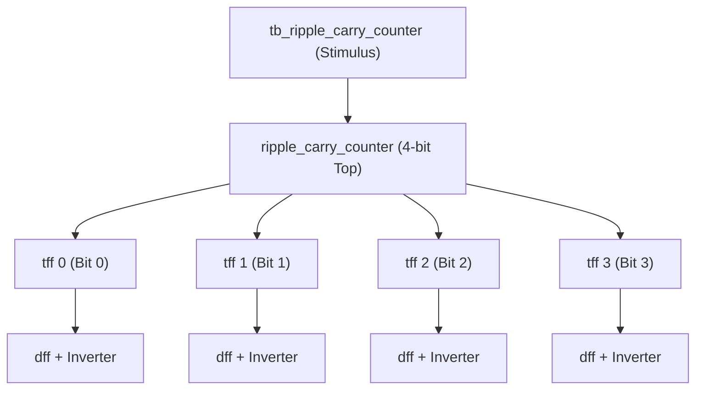
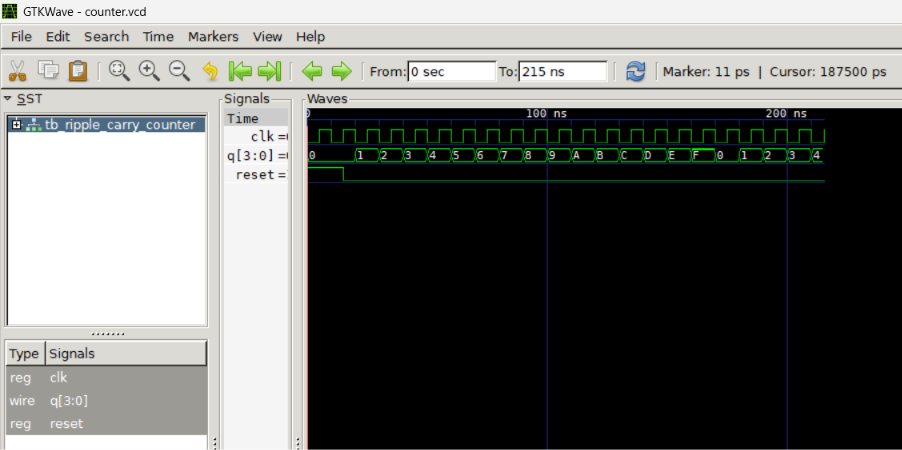

# Chapter 2: Hierarchical Modeling (4-bit Ripple Carry Counter)

Following **Chapter 2** of *Verilog HDL: A Guide to Digital Design and Synthesis* by Samir Palnitkar.

---

## 📌 Architecture & Hierarchy

The 4-bit ripple carry counter demonstrates modular, hierarchical digital design:



- **`dff.v`**: Negative-edge triggered D-Flip-Flop with active-high asynchronous reset.
- **`tff.v`**: Toggle Flip-Flop created by connecting `q_bar` back into `d`.
- **`ripple_carry_counter.v`**: 4-bit asynchronous counter where output `q[n]` clocks stage `q[n+1]`.
- **`tb_ripple_carry_counter.v`**: Self-checking stimulus module with 10ns clock, reset pulse, and `$dumpfile` for GTKWave.

---

## 📊 GTKWave Simulation Waveform



### Key Observations from Waveform:
1. **Asynchronous Reset**: At $t = 0\text{ ns}$ to $15\text{ ns}$, `reset` is high (`1`), forcing `q[3:0] = 0000`.
2. **Counting Sequence**: Once reset de-asserts, the counter increments on each clock falling edge: `0 -> 1 -> 2 -> ... -> F (15) -> 0`.
3. **Ripple Action**: Bit 0 toggles at half the clock frequency, Bit 1 at one-fourth, Bit 2 at one-eighth, and Bit 3 at one-sixteenth.

---

## 🚀 How to Run Simulation

```bash
# 1. Compile
iverilog -o sim.vvp dff.v tff.v ripple_carry_counter.v tb_ripple_carry_counter.v

# 2. Simulate
vvp sim.vvp

# 3. View Waveforms
gtkwave counter.vcd
```
