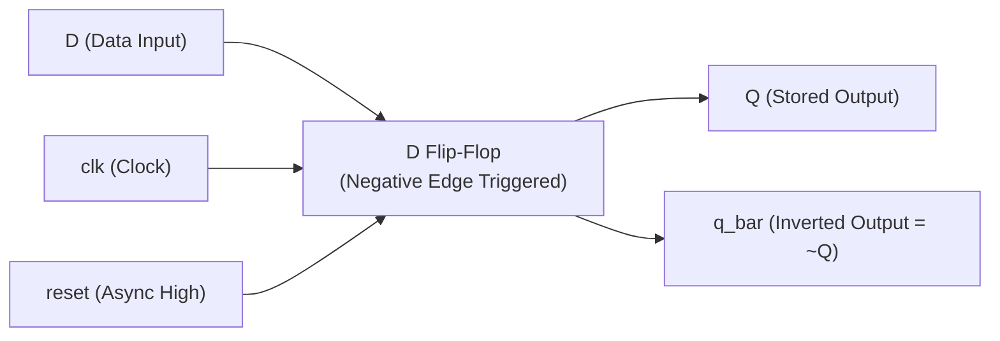
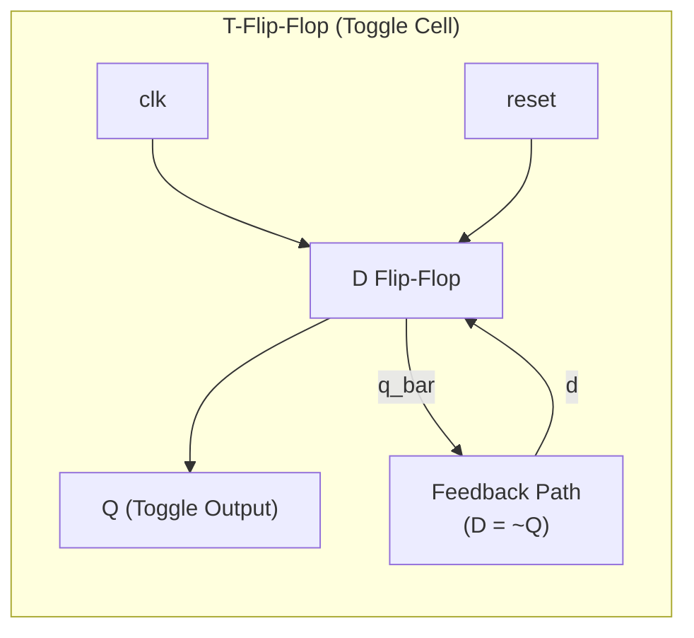

# Chapter 2: Hierarchical Modeling — Circuit Theory, Schematics & Step-by-Step Derivation

Reference: *Verilog HDL: A Guide to Digital Design and Synthesis* by Samir Palnitkar (Chapter 2, Sections 2.1 – 2.4).

---

## 1. Circuit Component 1: D Flip-Flop (D-FF)

### 1.1 Circuit Description
A **D Flip-Flop** (Data / Delay Flip-Flop) is a fundamental sequential storage element that samples its input `D` and transfers it to output `Q` upon a specific clock transition.
In our design:
- **Trigger**: Negative Edge of Clock (`negedge clk`).
- **Reset**: Active-High Asynchronous Reset (`posedge reset`). Whenever `reset = 1`, `Q` is immediately forced to `0` regardless of clock.

### 1.2 State Transition Table (Truth Table)

| `reset` | `clk` | `D` | $Q_{next}$ | $\overline{Q}_{next}$ | Description / State |
| :---: | :---: | :---: | :---: | :---: | :--- |
| **`1`** | `X` | `X` | **`0`** | **`1`** | **Asynchronous Reset (Forced Low)** |
| **`0`** | `0` or `1` or $\uparrow$ | `X` | $Q$ | $\overline{Q}$ | No Change (Latch state) |
| **`0`** | $\downarrow$ (Falling Edge) | **`0`** | **`0`** | **`1`** | Reset on Clock Edge |
| **`0`** | $\downarrow$ (Falling Edge) | **`1`** | **`1`** | **`0`** | Set on Clock Edge |

### 1.3 Circuit Schematic



---

## 2. Circuit Component 2: Toggle Flip-Flop (T-FF)

### 2.1 Derivation: Converting D-FF to T-FF
A **Toggle Flip-Flop** inverts its state on every active clock edge:
$$Q(t+1) = \overline{Q}(t)$$

In a standard D-FF, the next state is determined by input $D$:
$$Q(t+1) = D$$

By connecting the complementary output $\overline{Q}$ (or `q_bar`) back into the data input $D$:
$$D = \overline{Q}$$
Substituting $D$ gives:
$$Q(t+1) = \overline{Q}(t)$$

Hence, on every falling clock edge, the flip-flop toggles between `0` and `1`.

### 2.2 T-FF State Transition Table

| Current State $Q(t)$ | Clock Event | Next State $Q(t+1)$ | Complement $\overline{Q}(t+1)$ |
| :---: | :---: | :---: | :---: |
| **`0`** | $\downarrow$ (Falling Edge) | **`1`** | **`0`** |
| **`1`** | $\downarrow$ (Falling Edge) | **`0`** | **`1`** |

### 2.3 Circuit Schematic (D-FF with Inverted Feedback Loop)



---

## 3. Top-Level System: 4-Bit Asynchronous Ripple Carry Counter

### 3.1 Step-by-Step Circuit Operation
A 4-bit binary counter counts cyclically through 16 states: $0000_2 \to 1111_2 \to 0000_2$.
- **Bit 0 ($Q_0$)**: Toggled directly by the primary system clock `clk`. Toggles every negative clock edge.
- **Bit 1 ($Q_1$)**: Clocked by $Q_0$. It only toggles when $Q_0$ transitions from `1` to `0` ($\downarrow$).
- **Bit 2 ($Q_2$)**: Clocked by $Q_1$. Toggles when $Q_1$ transitions from `1` to `0` ($\downarrow$).
- **Bit 3 ($Q_3$)**: Clocked by $Q_2$. Toggles when $Q_2$ transitions from `1` to `0` ($\downarrow$).

Because the clock is not applied simultaneously to all flip-flops, the clock transition "ripples" through the chain from LSB to MSB. This is why it is called an **Asynchronous Ripple Counter**.

### 3.2 16-State Truth / Counting Table

| Clock Cycle ($\downarrow$) | $Q_3$ (Bit 3) | $Q_2$ (Bit 2) | $Q_1$ (Bit 1) | $Q_0$ (Bit 0) | Binary ($Q[3:0]$) | Decimal Value |
| :---: | :---: | :---: | :---: | :---: | :---: | :---: |
| **Reset** | 0 | 0 | 0 | 0 | `0000` | 0 |
| **1** | 0 | 0 | 0 | 1 | `0001` | 1 |
| **2** | 0 | 0 | 1 | 0 | `0010` | 2 |
| **3** | 0 | 0 | 1 | 1 | `0011` | 3 |
| **4** | 0 | 1 | 0 | 0 | `0100` | 4 |
| **5** | 0 | 1 | 0 | 1 | `0101` | 5 |
| **6** | 0 | 1 | 1 | 0 | `0110` | 6 |
| **7** | 0 | 1 | 1 | 1 | `0111` | 7 |
| **8** | 1 | 0 | 0 | 0 | `1000` | 8 |
| **9** | 1 | 0 | 0 | 1 | `1001` | 9 |
| **10** | 1 | 0 | 1 | 0 | `1010` | 10 |
| **11** | 1 | 0 | 1 | 1 | `1011` | 11 |
| **12** | 1 | 1 | 0 | 0 | `1100` | 12 |
| **13** | 1 | 1 | 0 | 1 | `1101` | 13 |
| **14** | 1 | 1 | 1 | 0 | `1110` | 14 |
| **15** | 1 | 1 | 1 | 1 | `1111` | 15 |
| **16 (Roll-over)** | 0 | 0 | 0 | 0 | `0000` | 0 |

---

### 3.3 Complete 4-Bit Ripple Counter Schematic

```mermaid
flowchart LR
    SYS_CLK["System clk"] -->|clk| TFF0["tff 0\n(Bit 0)"]
    RST["reset"] --> TFF0 & TFF1 & TFF2 & TFF3

    TFF0 -->|q[0]| TFF1["tff 1\n(Bit 1)"]
    TFF1 -->|q[1]| TFF2["tff 2\n(Bit 2)"]
    TFF2 -->|q[2]| TFF3["tff 3\n(Bit 3)"]

    TFF0 --> Q0["Q[0] (Frequency = f/2)"]
    TFF1 --> Q1["Q[1] (Frequency = f/4)"]
    TFF2 --> Q2["Q[2] (Frequency = f/8)"]
    TFF3 --> Q3["Q[3] (Frequency = f/16)"]
```

---

## 4. Frequency Division Analysis

Each T-flip-flop stage divides the input frequency by a factor of 2:
- Frequency of $Q_0$: $f_0 = \frac{f_{clk}}{2}$
- Frequency of $Q_1$: $f_1 = \frac{f_0}{2} = \frac{f_{clk}}{4}$
- Frequency of $Q_2$: $f_2 = \frac{f_1}{2} = \frac{f_{clk}}{8}$
- Frequency of $Q_3$: $f_3 = \frac{f_2}{2} = \frac{f_{clk}}{16}$

### Ripple Propagation Delay Notice:
Because stage $n$ must wait for stage $n-1$ to switch, the total delay to update the MSB ($Q_3$) is:
$$T_{total\_delay} = 4 \times t_{pd(FF)}$$
where $t_{pd(FF)}$ is the propagation delay of an individual flip-flop.
