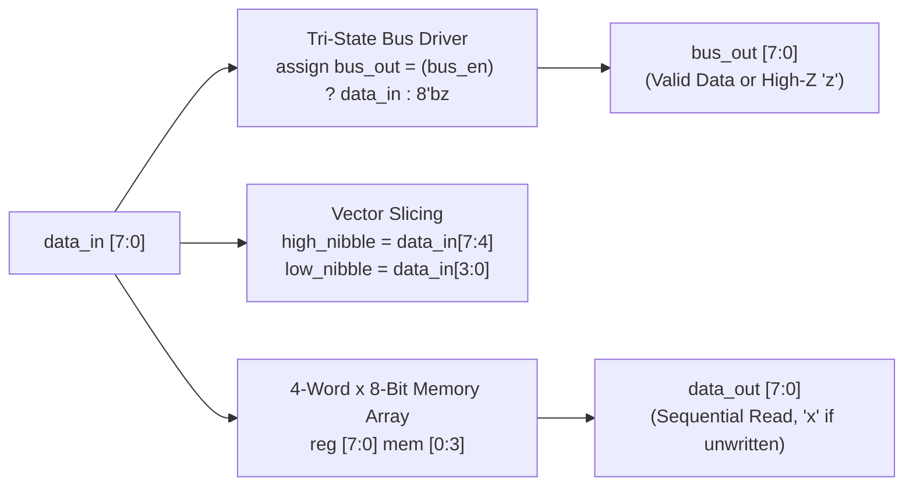
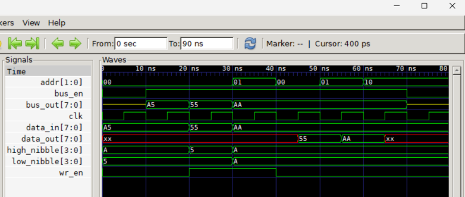

# Chapter 3: Basic Concepts (Data Types, Vectors & 4-State Logic)

Following **Chapter 3** of *Verilog HDL: A Guide to Digital Design and Synthesis* by Samir Palnitkar.

---

## 📌 Architecture & Design Concepts

This lab demonstrates the fundamental building blocks of digital logic modeling in Verilog:



### Core Concepts Covered:
1. **The 4-Value Logic System**:
   - `0`: Logic low / Ground.
   - `1`: Logic high / Power ($V_{dd}$).
   - `x`: Unknown / uninitialized state (displayed in **red** in GTKWave).
   - `z`: High-impedance / disconnected tri-state bus (displayed in **yellow** in GTKWave).
2. **Nets vs. Registers**:
   - `wire`: Used for continuously driven signals (`bus_out`, `high_nibble`, `low_nibble`).
   - `reg`: Used for procedural variables and storage elements (`data_out`, `mem`).
3. **Vector Slicing**: Extracting bit-ranges (`[7:4]` and `[3:0]`) from an 8-bit bus.
4. **Memory Arrays**: Declaring a two-dimensional memory array: `reg [7:0] mem [0:3];`.
5. **System Tasks & Directives**: Utilizing `$display`, `$monitor`, `$time`, `$finish`, and `` `timescale ``.

---

## 📊 GTKWave Simulation Waveform



### Key Waveform Observations:
1. **High-Impedance (`z`) in Action**:
   - At $t = 0\text{ns}$ to $10\text{ns}$ and after $70\text{ns}$, `bus_en = 0`. Notice that `bus_out[7:0]` displays as a thin **yellow line (`0xzz`)**.
   - When `bus_en = 1`, `bus_out` drives valid green digital values (`0xA5`, `0x55`, `0xAA`).
2. **Unknown State (`x`) in Action**:
   - At $t = 0\text{ns}$ to $45\text{ns}$, `data_out[7:0]` displays as a solid **red line (`0xxx`)** because memory address 0 was read before being initialized.
   - At $t = 45\text{ns}$ and $55\text{ns}$, it reads back the written values `0x55` and `0xAA`.
   - At $t = 65\text{ns}$, reading address 2 (binary `10`) returns **red (`0xxx`)** because address 2 was never written!
3. **Vector Part-Select**:
   - For `data_in = 8'hA5`, `high_nibble` correctly isolates `4'hA` and `low_nibble` isolates `4'h5`.

---

## 🚀 How to Run Simulation

```bash
# 1. Compile
C:\iverilog\bin\iverilog.exe -o sim.vvp data_types_demo.v tb_data_types_demo.v

# 2. Simulate
C:\iverilog\bin\vvp.exe sim.vvp

# 3. View Waveforms
C:\iverilog\gtkwave\bin\gtkwave.exe data_types.vcd
```
