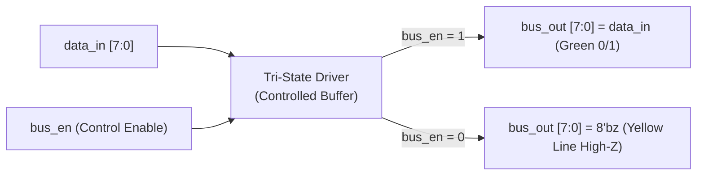
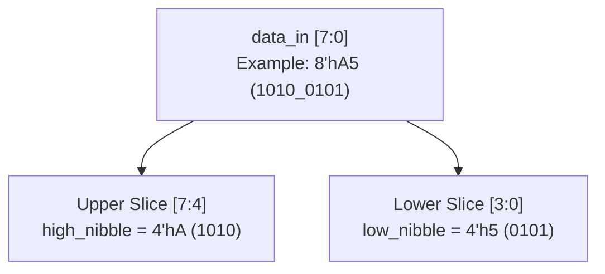
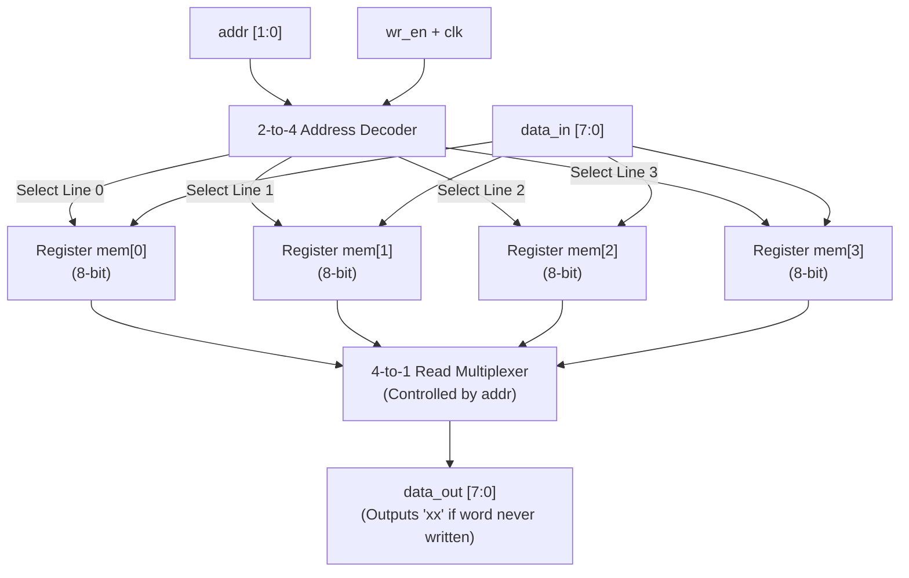

# Chapter 3: Basic Concepts — Data Types, 4-State Logic & Circuit Theory

Reference: *Verilog HDL: A Guide to Digital Design and Synthesis* by Samir Palnitkar (Chapter 3, Sections 3.1 – 3.3).

---

## 1. The 4-State Digital Logic System

In real digital electronic circuits, signals are not restricted to just binary `0` and `1`. Verilog defines four fundamental logic values:

| Logic Value | Electrical Physical Meaning | Simulator / Waveform Representation | Example Scenario in Hardware |
| :---: | :--- | :--- | :--- |
| **`0`** | **Logic Low / Ground ($0\text{V}$)** | Green Low Line | Pull-down transistor active, logic false |
| **`1`** | **Logic High / Power ($V_{dd}$ / $3.3\text{V}$ / $1.8\text{V}$)** | Green High Line | Pull-up transistor active, logic true |
| **`x`** | **Unknown / Conflict / Contention** | **Red Highlight Line (`xx`)** | Uninitialized flip-flop/RAM, or two drivers conflicting ($1$ vs $0$) |
| **`z`** | **High-Impedance / Floating / Open-Circuit** | **Yellow Thin / Dashed Line (`zz`)** | Tri-state buffer disabled (output disconnected from bus) |

---

### 1.1 Behavior of Logic Gates with 4-State Values

#### AND Gate with 4-State Inputs
| `A \ B` | **`0`** | **`1`** | **`x`** | **`z`** |
| :---: | :---: | :---: | :---: | :---: |
| **`0`** | `0` | `0` | `0` | `0` |
| **`1`** | `0` | `1` | `x` | `x` |
| **`x`** | `0` | `x` | `x` | `x` |
| **`z`** | `0` | `x` | `x` | `x` |

> *Rule*: If any input to an AND gate is `0`, the output is guaranteed `0` (even if the other input is unknown `x` or high-Z `z`).

#### OR Gate with 4-State Inputs
| `A \ B` | **`0`** | **`1`** | **`x`** | **`z`** |
| :---: | :---: | :---: | :---: | :---: |
| **`0`** | `0` | `1` | `x` | `x` |
| **`1`** | `1` | `1` | `1` | `1` |
| **`x`** | `x` | `1` | `x` | `x` |
| **`z`** | `x` | `1` | `x` | `x` |

> *Rule*: If any input to an OR gate is `1`, the output is guaranteed `1` regardless of `x` or `z`.

---

## 2. Tri-State Bus Driver (Buffer) Circuit

### 2.1 Why Tri-State Logic is Required in Hardware
In a computer system, multiple peripherals (Memory, GPU, CPU, UART) must share a common bidirectional data bus.
- If two devices drive the bus at the same time ($1$ vs $0$), an electrical **short circuit (bus contention)** occurs, burning power and producing unknown `x`.
- A **Tri-State Buffer** disconnects inactive chips from the bus by placing their output in a high-impedance (`z`) state, effectively acting as an open switch.

### 2.2 Tri-State Buffer Truth Table

| Control Enable (`bus_en`) | Data Input (`data_in`) | Bus Output (`bus_out`) | Electrical State |
| :---: | :---: | :---: | :--- |
| **`0`** | `X` (Don't Care) | **`8'bzzzz_zzzz` (`z`)** | **High-Impedance (Disconnected / Floating)** |
| **`1`** | `0` | `0` | Actively Driven Low |
| **`1`** | `1` | `1` | Actively Driven High |

### 2.3 Tri-State Buffer Circuit Schematic

---

## 3. Vector Slicing & Bus Splitting

In digital hardware, wider data buses (e.g., 8-bit bytes) are frequently decomposed into smaller chunks (e.g., 4-bit nibbles):
- **Input Bus**: `data_in[7:0]` (Bits: $b_7, b_6, b_5, b_4, b_3, b_2, b_1, b_0$)
- **High Nibble**: `data_in[7:4]` (Bits: $b_7, b_6, b_5, b_4$)
- **Low Nibble**: `data_in[3:0]` (Bits: $b_3, b_2, b_1, b_0$)

### 3.1 Bit-Level Decomposition Example
For input `data_in = 8'hA5`:
$$\text{Binary: } 1010\_0101_2$$
- `high_nibble = data_in[7:4]` $\implies 1010_2 = \mathbf{4'hA}$
- `low_nibble = data_in[3:0]` $\implies 0101_2 = \mathbf{4'h5}$

---

## 4. 4-Word x 8-Bit Register File (Memory Array)

### 4.1 Internal Architecture
A memory array consists of:
1. **Address Decoder (2-to-4)**: Converts a 2-bit binary address into 4 one-hot word lines.
2. **Storage Registers**: Four 8-bit registers (`mem[0]`, `mem[1]`, `mem[2]`, `mem[3]`).
3. **Write Control (`wr_en`)**: Synchronous clock enables data loading.
4. **Read Multiplexer**: Routes the addressed word to `data_out`.

### 4.2 Address Decoding Table

| `addr[1]` | `addr[0]` | Selected Memory Word | Addressed Word Register |
| :---: | :---: | :---: | :--- |
| `0` | `0` | Word 0 | `mem[0]` (8-bit storage) |
| `0` | `1` | Word 1 | `mem[1]` (8-bit storage) |
| `1` | `0` | Word 2 | `mem[2]` (8-bit storage) |
| `1` | `1` | Word 3 | `mem[3]` (8-bit storage) |

### 4.3 Why Uninitialized Memory Reads as `x` (Unknown)
In hardware simulation, static RAM (SRAM) cells power up in an unpredictable state until written.
- Before a write to address $N$, reading `mem[N]` yields **`8'hxx`** (solid red line in GTKWave).
- After writing `8'h55` to `mem[0]`, subsequent reads yield clean digital data `8'h55`.

### 4.4 Memory Array Circuit Schematic

