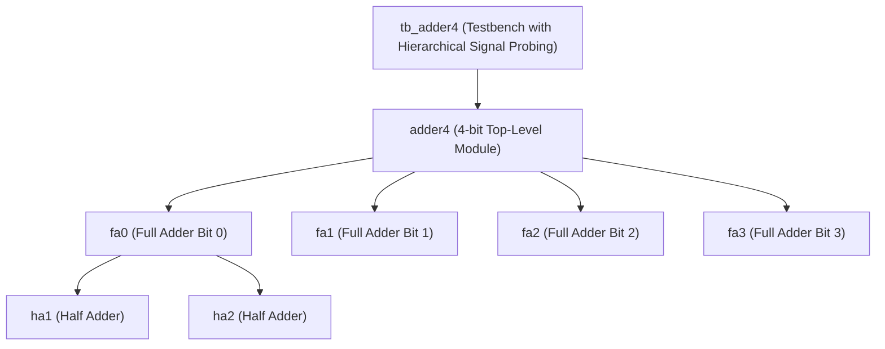
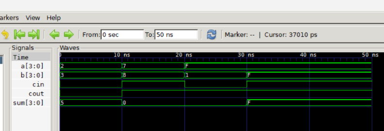

# Chapter 4: Modules and Ports (Hierarchical 4-bit Ripple Carry Adder)

Following **Chapter 4** of *Verilog HDL: A Guide to Digital Design and Synthesis* by Samir Palnitkar.

---

## 📌 Architecture & Design Hierarchy

This lab demonstrates modular digital design, port connection rules, and hierarchical signal probing:



### Core Concepts Covered:
1. **Module Hierarchy & Leaf Cells**:
   - `half_adder.v`: Basic building block computing sum and carry of 2 single bits.
   - `full_adder.v`: Intermediate module constructed by instantiating two `half_adder` leaf cells and an OR gate.
   - `adder4.v`: Top-level 4-bit module cascading four `full_adder` instances with internal carry chain (`c1`, `c2`, `c3`).
2. **Port Connection Rules**:
   - **Connection by Name (`.port_name(signal_name)`)**: Used throughout the hierarchy to ensure safe, order-independent port mapping (Industry Standard).
   - **Internal vs. External Rules**: All inputs inside modules are declared as `wire`.
3. **Hierarchical Signal Probing**:
   - The testbench accesses internal signals using dot notation (`dut.c1`, `dut.c2`, `dut.c3`) to verify stage-by-stage carry propagation without routing debug signals to top-level pins.

---

## 📊 GTKWave Simulation Waveform



### Key Waveform Observations:
1. **Addition Without Carry**:
   - $t = 0\text{ns} - 10\text{ns}$: $a = 2, b = 3, cin = 0 \implies \mathbf{sum = 5, cout = 0}$.
2. **Addition With Carry-In**:
   - $t = 10\text{ns} - 20\text{ns}$: $a = 7, b = 8, cin = 1 \implies 7 + 8 + 1 = 16 \implies \mathbf{sum = 0, cout = 1}$.
   - The carry ripples across all 4 stages (`c1=1, c2=1, c3=1`).
3. **Overflow Condition**:
   - $t = 20\text{ns} - 30\text{ns}$: $a = 15\,(F), b = 1, cin = 0 \implies 15 + 1 = 16 \implies \mathbf{sum = 0, cout = 1}$.
4. **Full Scale Addition**:
   - $t = 30\text{ns} - 50\text{ns}$: $a = 15\,(F), b = 15\,(F), cin = 1 \implies 15 + 15 + 1 = 31 \implies \mathbf{sum = 15\,(F), cout = 1}$.

---

## 🚀 How to Run Simulation

```bash
# 1. Compile
C:\iverilog\bin\iverilog.exe -o sim.vvp half_adder.v full_adder.v adder4.v tb_adder4.v

# 2. Simulate
C:\iverilog\bin\vvp.exe sim.vvp

# 3. View Waveforms
C:\iverilog\gtkwave\bin\gtkwave.exe adder4.vcd
```
