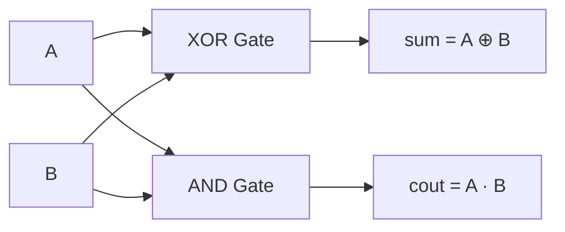
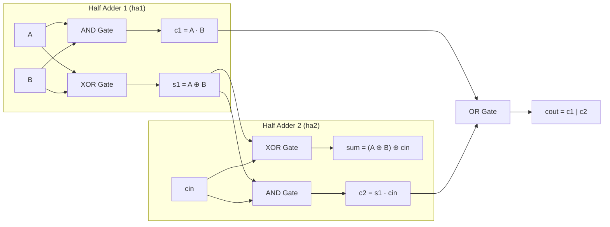
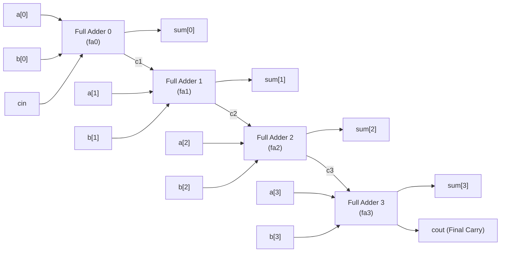

# Chapter 4: Modules and Ports — Circuit Theory, Schematics & Full Derivations

Reference: *Verilog HDL: A Guide to Digital Design and Synthesis* by Samir Palnitkar (Chapter 4, Sections 4.1 – 4.3).

---

## 1. Circuit Component 1: 1-Bit Half Adder (HA)

### 1.1 Circuit Description
A **Half Adder** adds two single-bit binary numbers $A$ and $B$, generating a 1-bit `Sum` and a 1-bit Carry-Out (`Cout`). It does not accept a carry-in from a previous stage.

### 1.2 Truth Table

| Input $A$ | Input $B$ | Addition ($A + B$) | Output `Sum` ($S$) | Output Carry `Cout` ($C$) |
| :---: | :---: | :---: | :---: | :---: |
| `0` | `0` | $0 + 0 = 0$ | **`0`** | **`0`** |
| `0` | `1` | $0 + 1 = 1$ | **`1`** | **`0`** |
| `1` | `0` | $1 + 0 = 1$ | **`1`** | **`0`** |
| `1` | `1` | $1 + 1 = 2_{10} = 10_2$ | **`0`** | **`1`** |

### 1.3 Boolean Equations
From the truth table:
- **Sum ($S$)**: High when inputs are different $\implies$ **XOR operation**:
  $$Sum = A \oplus B = \overline{A}B + A\overline{B}$$
- **Carry-Out ($Cout$)**: High only when both inputs are $1 \implies$ **AND operation**:
  $$Cout = A \cdot B$$

### 1.4 Gate-Level Schematic

---

## 2. Circuit Component 2: 1-Bit Full Adder (FA)

### 2.1 Circuit Description
A **Full Adder** adds three single-bit inputs: two operand bits $A$ and $B$, plus a Carry-In bit $Cin$ from the preceding less-significant stage.

### 2.2 Complete 8-Row Truth Table

| Row # | $A$ | $B$ | $Cin$ | Total Sum ($A+B+Cin$) | Output `Sum` | Output `Cout` |
| :---: | :---: | :---: | :---: | :---: | :---: | :---: |
| **0** | `0` | `0` | `0` | $0$ | **`0`** | **`0`** |
| **1** | `0` | `0` | `1` | $1$ | **`1`** | **`0`** |
| **2** | `0` | `1` | `0` | $1$ | **`1`** | **`0`** |
| **3** | `0` | `1` | `1` | $2_{10} = 10_2$ | **`0`** | **`1`** |
| **4** | `1` | `0` | `0` | $1$ | **`1`** | **`0`** |
| **5** | `1` | `0` | `1` | $2_{10} = 10_2$ | **`0`** | **`1`** |
| **6** | `1` | `1` | `0` | $2_{10} = 10_2$ | **`0`** | **`1`** |
| **7** | `1` | `1` | `1` | $3_{10} = 11_2$ | **`1`** | **`1`** |

---

### 2.3 Step-by-Step Derivation Using Two Half Adders

We construct a Full Adder hierarchically by cascading **two Half Adders** and **one OR gate**:

#### Stage 1: First Half Adder (`ha1`)
Adds $A$ and $B$:
- Intermediate sum: $s_1 = A \oplus B$
- Intermediate carry: $c_1 = A \cdot B$

#### Stage 2: Second Half Adder (`ha2`)
Adds intermediate sum $s_1$ and the carry-in $Cin$:
- Final sum:
  $$Sum = s_1 \oplus Cin = (A \oplus B) \oplus Cin$$
- Second intermediate carry:
  $$c_2 = s_1 \cdot Cin = (A \oplus B) \cdot Cin$$

#### Stage 3: Final Carry Out (`cout`)
A carry is generated if **either** the first half adder generated a carry ($c_1$) **OR** the second half adder generated a carry ($c_2$):
$$Cout = c_1 + c_2 = (A \cdot B) + ((A \oplus B) \cdot Cin)$$

*(Note: $c_1$ and $c_2$ can never be 1 at the same time, so an OR gate produces the exact required logic).*

---

### 2.4 Hierarchical Full Adder Schematic

---

## 3. Top-Level System: 4-Bit Ripple Carry Adder (`adder4`)

### 3.1 Step-by-Step Circuit Operation
To add two 4-bit numbers $A[3:0]$ and $B[3:0]$ with input carry $Cin$, we cascade four 1-bit full adders:
- **Bit 0**: Adds $A[0], B[0], Cin \implies Sum[0]$ and generates carry $c_1$.
- **Bit 1**: Adds $A[1], B[1], c_1 \implies Sum[1]$ and generates carry $c_2$.
- **Bit 2**: Adds $A[2], B[2], c_2 \implies Sum[2]$ and generates carry $c_3$.
- **Bit 3**: Adds $A[3], B[3], c_3 \implies Sum[3]$ and generates final overflow carry $Cout$.

---

### 3.2 4-Bit Ripple Carry Adder Schematic

---

## 4. Arithmetic Trace Examples (Verified in Simulation)

### Example 1: Simple Addition without Carry ($2 + 3 = 5$)
- Inputs: $A = 0010_2$ (2), $B = 0011_2$ (3), $Cin = 0$
- **Bit 0**: $A[0]=0, B[0]=1, Cin=0 \implies Sum[0]=1, c_1=0$
- **Bit 1**: $A[1]=1, B[1]=1, c_1=0 \implies Sum[1]=0, c_2=1$
- **Bit 2**: $A[2]=0, B[2]=0, c_2=1 \implies Sum[2]=1, c_3=0$
- **Bit 3**: $A[3]=0, B[3]=0, c_3=0 \implies Sum[3]=0, Cout=0$
- **Result**: $Sum = 0101_2 = \mathbf{5}$, $Cout = \mathbf{0}$.

---

### Example 2: Ripple Carry Ripple across All 4 Stages ($7 + 8 + 1 = 16$)
- Inputs: $A = 0111_2$ (7), $B = 1000_2$ (8), $Cin = 1$
- **Bit 0**: $1 + 0 + 1 = 2 \implies Sum[0] = 0, \mathbf{c_1 = 1}$
- **Bit 1**: $1 + 0 + 1 = 2 \implies Sum[1] = 0, \mathbf{c_2 = 1}$
- **Bit 2**: $1 + 0 + 1 = 2 \implies Sum[2] = 0, \mathbf{c_3 = 1}$
- **Bit 3**: $0 + 1 + 1 = 2 \implies Sum[3] = 0, \mathbf{Cout = 1}$
- **Result**: $Sum = 0000_2 = \mathbf{0}$, $Cout = \mathbf{1}$ (Total $= 16_{10}$).

---

## 5. Timing & Propagation Delay Analysis

In a Ripple Carry Adder, the speed is limited by the time required for the carry signal to propagate from the LSB to the MSB:
$$T_{total} = T_{HA1} + (N - 1) \times T_{carry\_chain} + T_{sum}$$
For an $N$-bit adder, propagation delay scales linearly with bit-width:
$$T_{delay} \propto \mathcal{O}(N)$$
*(In later chapters, we will learn how Carry Lookahead Adders (CLA) break this carry delay chain using parallel generate/propagate logic).*
