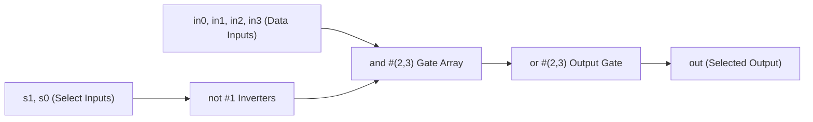
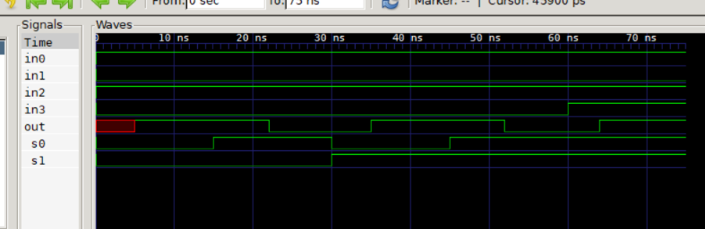

# Chapter 5: Gate-Level Modeling (4-to-1 Multiplexer with Gate Delays)

Following **Chapter 5** of *Verilog HDL: A Guide to Digital Design and Synthesis* by Samir Palnitkar.

---

## 📌 Architecture & Circuit Purpose

This lab demonstrates structural digital design using built-in gate primitives (`not`, `and`, `or`) and physical propagation delay modeling:



### Core Concepts Covered:
1. **Gate Primitives Syntax**:
   - Built-in primitives: `not`, `and`, `or`.
   - Port order rule: Output terminal is strictly listed **first** (`and (out, in1, in2)`).
2. **Rise & Fall Gate Delays**:
   - `#(rise, fall)` specifies asymmetric switching delays (e.g., `#(2, 3)`).
3. **Propagation Delay Path**:
   - Observing physical delay transitions in simulation waveforms.

---

## 📊 GTKWave Simulation Waveform



### Key Waveform Observations:
1. **Channel Selection**:
   - $s_1 s_0 = 00 \implies out = in_0 = 1$
   - $s_1 s_0 = 01 \implies out = in_1 = 0$
   - $s_1 s_0 = 10 \implies out = in_2 = 1$
   - $s_1 s_0 = 11 \implies out = in_3 = 0$
2. **Propagation Delay Lag**:
   - When select lines change at $t = 15\text{ns}$, the output `out` does not switch immediately at $15\text{ns}$; it updates after gate propagation delay ($\approx 5\text{ns}$ later)!

---

## 🚀 How to Run Simulation

```bash
# 1. Compile
C:\iverilog\bin\iverilog.exe -o sim.vvp mux4_to_1.v tb_mux4_to_1.v

# 2. Simulate
C:\iverilog\bin\vvp.exe sim.vvp

# 3. View Waveforms
C:\iverilog\gtkwave\bin\gtkwave.exe mux4_to_1.vcd
```
