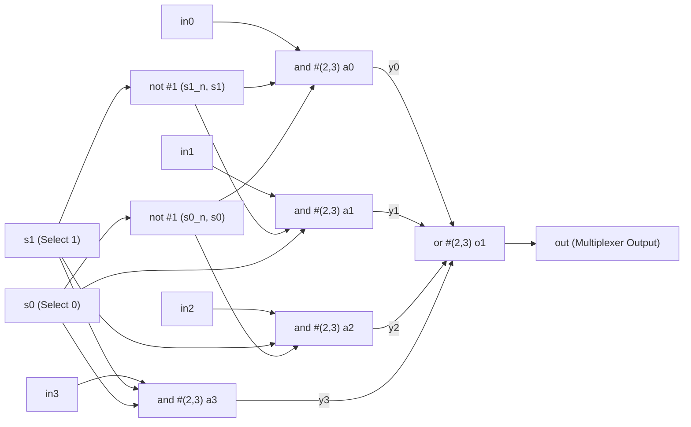

# Chapter 5: Gate-Level Modeling — Circuit Theory, Schematics & Delay Analysis

Reference: *Verilog HDL: A Guide to Digital Design and Synthesis* by Samir Palnitkar (Chapter 5, Sections 5.1 – 5.3).

---

## 1. What is Gate-Level Modeling?

In **Gate-Level Modeling**, digital circuits are constructed by explicitly connecting basic logic gate primitives (`and`, `nand`, `or`, `nor`, `xor`, `xnor`, `not`, `buf`).

### Key Rules of Verilog Gate Primitives:
1. **Output is Always First**: The first terminal in the connection list is strictly the output:
   ```verilog
   and a1 (out, in1, in2); // out = in1 & in2
   not n1 (out, in);       // out = ~in
   ```
2. **Multiple Inputs Supported**: Basic gates like `and`, `or` can have 2, 3, 4, or more inputs:
   ```verilog
   or o1 (out, y0, y1, y2, y3); // 4-input OR gate
   ```

---

## 2. 4-to-1 Multiplexer (MUX)

### 2.1 Circuit Description
A **4-to-1 Multiplexer** selects one of four data inputs (`in0`, `in1`, `in2`, `in3`) and forwards it to a single output line `out`, controlled by a 2-bit selection code (`s1`, `s0`).

### 2.2 Function / Truth Table

| Select Line $s_1$ | Select Line $s_0$ | Selected Channel | Output Equation | Active Data Source |
| :---: | :---: | :---: | :---: | :---: |
| **`0`** | **`0`** | Channel 0 | $out = in0$ | Input 0 |
| **`0`** | **`1`** | Channel 1 | $out = in1$ | Input 1 |
| **`1`** | **`0`** | Channel 2 | $out = in2$ | Input 2 |
| **`1`** | **`1`** | Channel 3 | $out = in3$ | Input 3 |

---

### 2.3 Boolean Derivation (Sum-of-Products)
Using standard minterms:
- Channel 0 is active when $s_1 = 0$ and $s_0 = 0 \implies \overline{s_1} \cdot \overline{s_0} \cdot in0$
- Channel 1 is active when $s_1 = 0$ and $s_0 = 1 \implies \overline{s_1} \cdot s_0 \cdot in1$
- Channel 2 is active when $s_1 = 1$ and $s_0 = 0 \implies s_1 \cdot \overline{s_0} \cdot in2$
- Channel 3 is active when $s_1 = 1$ and $s_0 = 1 \implies s_1 \cdot s_0 \cdot in3$

Combining all channels through an OR gate yields the complete Boolean equation:
$$out = (\overline{s_1} \cdot \overline{s_0} \cdot in0) + (\overline{s_1} \cdot s_0 \cdot in1) + (s_1 \cdot \overline{s_0} \cdot in2) + (s_1 \cdot s_0 \cdot in3)$$

---

### 2.4 Gate-Level Circuit Schematic



---

## 3. Propagation Delay Analysis in Silicon

In physical CMOS chips, logic gates do not switch instantaneously. There is a capacitive charging/discharging delay through the transistors.

Verilog models this using gate delays:
- **Rise Delay ($t_r$)**: Time taken for the gate output to transition from `0` to `1`.
- **Fall Delay ($t_f$)**: Time taken for the gate output to transition from `1` to `0`.
- **Syntax**: `gate_type #(rise_delay, fall_delay) instance_name (out, in1, in2);`

### In Our Circuit:
- Inverters `not`: Delay = **1ns**.
- AND gates: Rise = **2ns**, Fall = **3ns**.
- OR gate: Rise = **2ns**, Fall = **3ns**.

### Total Signal Propagation Path:
When select line `s0` switches:
1. Signal passes through `not` gate: **$\Delta t_1 = 1\text{ns}$**.
2. Signal passes through `and` gate: **$\Delta t_2 = 2\text{ns}$ or $3\text{ns}$**.
3. Signal passes through `or` gate: **$\Delta t_3 = 2\text{ns}$ or $3\text{ns}$**.
4. **Total Path Delay**:
   $$T_{propagation} = \Delta t_1 + \Delta t_2 + \Delta t_3 = 1\text{ns} + 2\text{ns} + 2\text{ns} = \mathbf{5\text{ns}}$$

When inspecting waveforms in GTKWave, observe that the output `out` switches **5ns after** the select inputs transition!
