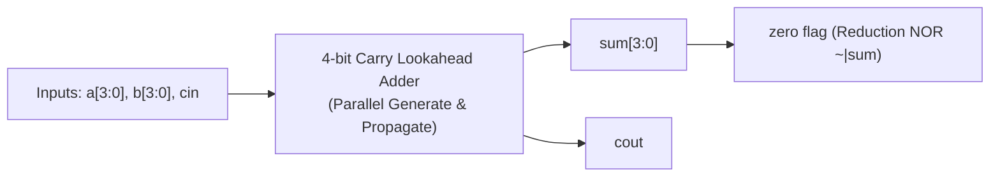
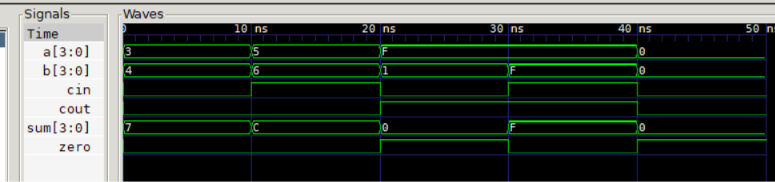

# Chapter 6: Dataflow Modeling (4-bit Carry Lookahead Adder)

Following **Chapter 6** of *Verilog HDL: A Guide to Digital Design and Synthesis* by Samir Palnitkar.

---

## 📌 Architecture & Circuit Purpose

This lab demonstrates modern synthesizable combinational logic using **Continuous Assignments (`assign`)**, bitwise operators, parallel lookahead carry logic, and reduction operators:



### Core Concepts Covered:
1. **Continuous Assignment (`assign`)**:
   - Hardware concurrency: live, continuous signal evaluation.
   - Target must always be a net (`wire`).
2. **Generate ($G$) & Propagate ($P$) Parallel Carry Logic**:
   - Eliminating the sequential ripple delay bottleneck ($T \propto \mathcal{O}(1)$).
3. **Reduction Operators**:
   - `assign zero = ~|sum;` (single-line zero-detector across all bits).

---

## 📊 GTKWave Simulation Waveform



### Key Waveform Observations:
1. **Standard Addition**:
   - $a = 3, b = 4, cin = 0 \implies \mathbf{sum = 7, cout = 0, zero = 0}$.
2. **Addition With Carry-in**:
   - $a = 5, b = 6, cin = 1 \implies \mathbf{sum = 12\,(C), cout = 0, zero = 0}$.
3. **Overflow with Zero Flag**:
   - $a = 15\,(F), b = 1, cin = 0 \implies \mathbf{sum = 0, cout = 1, zero = 1}$ (Reduction NOR flags zero!).
4. **Maximum Sum**:
   - $a = 15\,(F), b = 15\,(F), cin = 1 \implies \mathbf{sum = 15\,(F), cout = 1, zero = 0}$.

---

## 🚀 How to Run Simulation

```bash
# 1. Compile
C:\iverilog\bin\iverilog.exe -o sim.vvp cla_4bit.v tb_cla_4bit.v

# 2. Simulate
C:\iverilog\bin\vvp.exe sim.vvp

# 3. View Waveforms
C:\iverilog\gtkwave\bin\gtkwave.exe cla_4bit.vcd
```
