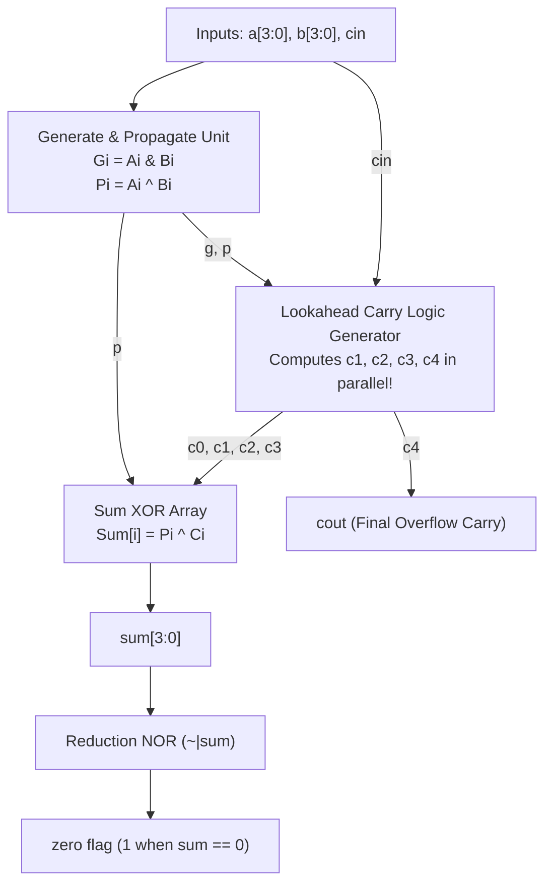

# Chapter 6: Dataflow Modeling — Circuit Theory, Schematics & Carry Lookahead Derivation

Reference: *Verilog HDL: A Guide to Digital Design and Synthesis* by Samir Palnitkar (Chapter 6, Sections 6.1 – 6.4).

---

## 1. What is Dataflow Modeling?

In **Dataflow Modeling**, hardware circuits are described by how data flows between registers and nets using **Continuous Assignments (`assign`)**.
- In Gate-Level modeling (Chapter 5), you specify the exact transistors/gates.
- In Dataflow modeling, you specify the **Boolean equations and expressions** directly using operators (`+`, `&`, `^`, `~|`).

---

## 2. The Problem with Ripple Carry Adders

In Chapters 2 and 4, we built a 4-bit Ripple Carry Adder.
In a Ripple Carry Adder, each bit $i$ must wait for the carry bit $C_{i}$ from stage $i-1$ before it can calculate its sum and next carry:
$$C_0 \to C_1 \to C_2 \to C_3 \to C_4$$

For an $N$-bit adder:
$$T_{delay} = N \times t_{gate}$$
As bit-width grows ($32$-bit or $64$-bit processors), this ripple delay creates a severe speed bottleneck!

---

## 3. The Carry Lookahead Adder (CLA) Solution

The **Carry Lookahead Adder** eliminates the ripple bottleneck by calculating **all carry bits simultaneously in parallel** using two intermediate variables:
1. **Generate ($G_i$)**: A carry is generated internally if both inputs are 1, regardless of input carry:
   $$G_i = A_i \cdot B_i$$
2. **Propagate ($P_i$)**: A carry is propagated through the stage if either input is 1:
   $$P_i = A_i \oplus B_i$$

---

### 3.1 Step-by-Step Derivation of Parallel Carries

In any adder stage:
$$C_{i+1} = G_i + P_i \cdot C_i$$

Now, we substitute recursively so that every carry bit depends **only on the primary inputs and $C_0$ (Cin)**, with zero dependency on intermediate carries:

#### Stage 1 Carry ($C_1$):
$$C_1 = G_0 + P_0 \cdot C_0$$

#### Stage 2 Carry ($C_2$):
$$C_2 = G_1 + P_1 \cdot C_1$$
Substituting $C_1$:
$$C_2 = G_1 + P_1(G_0 + P_0 \cdot C_0) = \mathbf{G_1 + P_1 G_0 + P_1 P_0 C_0}$$

#### Stage 3 Carry ($C_3$):
$$C_3 = G_2 + P_2 \cdot C_2$$
Substituting $C_2$:
$$C_3 = \mathbf{G_2 + P_2 G_1 + P_2 P_1 G_0 + P_2 P_1 P_0 C_0}$$

#### Stage 4 Carry / Carry-Out ($C_4 = Cout$):
$$C_4 = G_3 + P_3 \cdot C_3$$
Substituting $C_3$:
$$C_4 = \mathbf{G_3 + P_3 G_2 + P_3 P_2 G_1 + P_3 P_2 P_1 G_0 + P_3 P_2 P_1 P_0 C_0}$$

---

### 3.2 Parallel Sum Computation
Once the carry vector $C[3:0]$ is generated in parallel:
$$Sum_i = P_i \oplus C_i$$
For all 4 bits:
- $Sum_0 = P_0 \oplus C_0$
- $Sum_1 = P_1 \oplus C_1$
- $Sum_2 = P_2 \oplus C_2$
- $Sum_3 = P_3 \oplus C_3$

All sum bits are computed concurrently with only **2 gate delays total** ($\mathcal{O}(1)$ time complexity)!

---

## 4. Carry Lookahead Adder Circuit Schematic



---

## 5. Supercharged Operator: Reduction NOR (`~|`)

In Chapter 6, Palnitkar introduces **Reduction Operators**. 
A reduction operator takes a multi-bit vector and folds all bits into a single 1-bit result:

```verilog
assign zero = ~|sum;
```

### Truth Table for Reduction NOR on 4-bit Vector:
$$\sim|(sum) = \overline{sum[3] + sum[2] + sum[1] + sum[0]}$$

- If `sum = 4'b0000`: $\overline{0 + 0 + 0 + 0} = \overline{0} = \mathbf{1}$ (Zero Flag Set!)
- If `sum = 4'b0001`: $\overline{0 + 0 + 0 + 1} = \overline{1} = \mathbf{0}$
- If `sum = 4'b1111`: $\overline{1 + 1 + 1 + 1} = \overline{1} = \mathbf{0}$

This single line replaces an entire 4-input NOR gate!

---

## 6. Delay Comparison: Ripple Carry vs. Carry Lookahead

| Parameter | Ripple Carry Adder (RCA) | Carry Lookahead Adder (CLA) |
| :--- | :---: | :---: |
| **Logic Delay for $N$ bits** | $\mathcal{O}(N)$ (Linear delay, slow) | $\mathcal{O}(1)$ (Constant gate levels, ultra-fast) |
| **Silicon Area / Gate Count** | Small (Few gates) | Moderate (Extra gates for carry expansion) |
| **Primary Industry Usage** | Low power / simple counters | High-speed CPUs, GPUs, DSP ALU cores |
