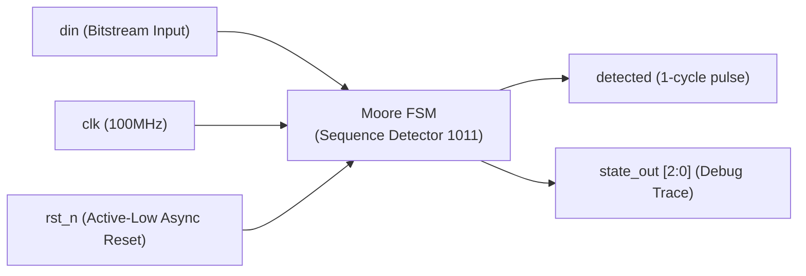
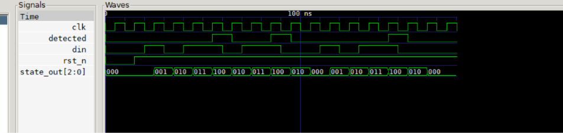

# Chapter 7: Behavioral Modeling (Overlapping Sequence Detector 1011)

Following **Chapter 7** of *Verilog HDL: A Guide to Digital Design and Synthesis* by Samir Palnitkar.

---

## 📌 Architecture & Design Purpose

This lab demonstrates modern synthesizable sequential logic and state machines using the **Industry-Standard 3-Process FSM Architecture**:



### Core Concepts Covered:
1. **The Golden RTL Rules**:
   - Sequential registers use `always @(posedge clk or negedge rst_n)` with **non-blocking (`<=`)**.
   - Combinational logic uses `always @(*)` with **blocking (`=`)**.
2. **Transparent Latch Prevention**:
   - Explicit `default` branches and pre-assigned default values in `always @(*)` blocks.
3. **Moore State Machine Design**:
   - Glitch-free outputs dependent solely on state registers.
4. **Overlapping Detection**:
   - Reusing suffix bits of a matched pattern to detect back-to-back sequences (`1011011` detects twice).

---

## 📊 GTKWave Simulation Waveform



### Key Waveform Observations:
1. **First Sequence Detection**:
   - Bit sequence `1 -> 0 -> 1 -> 1` drives states: `S_IDLE (0) -> S_1 (1) -> S_10 (2) -> S_101 (3) -> S_1011 (4)`.
   - In state `S_1011` (decimal 4), output **`detected = 1`** for 1 full clock cycle.
2. **Overlapping Second Detection**:
   - Immediate next bits `0 -> 1 -> 1` transition from `S_1011 -> S_10 (2) -> S_101 (3) -> S_1011 (4)`.
   - Output **`detected = 1`** triggers a second time without having to reset to IDLE!
3. **Third Detection After Interruption**:
   - The FSM handles invalid bits (`0 -> 0`) cleanly and detects the third `1011` sequence accurately.

---

## 🚀 How to Run Simulation

```bash
# 1. Compile
C:\iverilog\bin\iverilog.exe -o sim.vvp seq_detector_1011.v tb_seq_detector_1011.v

# 2. Simulate
C:\iverilog\bin\vvp.exe sim.vvp

# 3. View Waveforms
C:\iverilog\gtkwave\bin\gtkwave.exe seq_detector_1011.vcd
```
