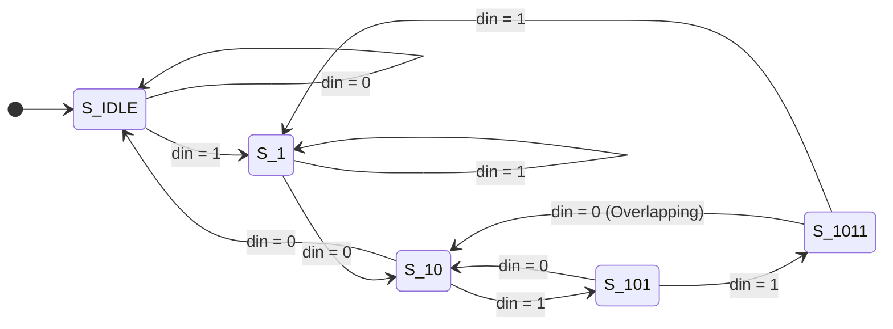
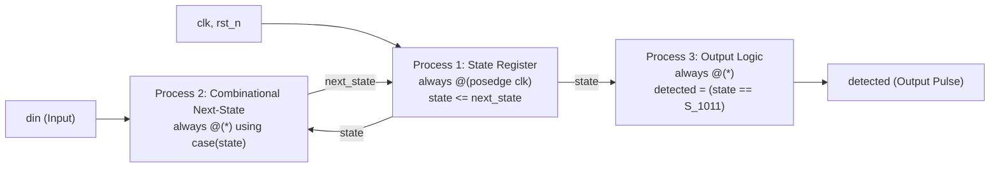

# Chapter 7: Behavioral Modeling — Finite State Machines & Procedural Assignments

Reference: *Verilog HDL: A Guide to Digital Design and Synthesis* by Samir Palnitkar (Chapter 7, Sections 7.1 – 7.10).

---

## 1. The Core Philosophy of Behavioral Modeling

In **Behavioral Modeling**, circuits are described by their algorithm, control flow, and state transitions rather than gate interconnections.
The two primary procedural blocks in Verilog are:
- **`initial` Block**: Executes exactly once starting at $t=0$. Used exclusively for testbenches and simulation stimulus. Non-synthesizable in ASIC design.
- **`always` Block**: Executes continuously in a loop throughout the simulation whenever its sensitivity list triggers. This is the cornerstone of synthesizable RTL design.

---

## 2. The Golden Rule: Blocking (`=`) vs. Non-Blocking (`<=`)

Understanding the distinction between blocking and non-blocking assignments is the single most critical concept in digital design.

| Property | Blocking Assignment (`=`) | Non-Blocking Assignment (`<=`) |
| :--- | :--- | :--- |
| **Execution Order** | Sequential (line-by-line). Evaluates and updates target immediately, blocking the next line. | Concurrent (parallel). Evaluates all RHS expressions simultaneously, then updates LHS at the end of the time step. |
| **Synthesizes To** | **Combinational logic** | **Sequential registers / Flip-Flops** |
| **Target Procedure** | `always @(*)` | `always @(posedge clk or negedge rst_n)` |
| **Hardware Danger** | Using `=` for registers causes simulation race conditions and simulation-synthesis mismatches. | Using `<=` for combinational logic wastes silicon area and infers redundant registers. |

### The Golden RTL Rules:
1. When modeling **sequential logic** (flip-flops, registers, counters), use `always @(posedge clk)` and **non-blocking (`<=`)**.
2. When modeling **combinational logic** (decoders, multiplexers, arithmetic), use `always @(*)` and **blocking (`=`)**.
3. **Never mix** `=` and `<=` inside the same `always` block.
4. **Never assign** to the same variable from more than one `always` block.

---

## 3. The Latch Inference Trap & Prevention

In hardware synthesis, an **unintentional latch** is inferred whenever a combinational variable is not explicitly assigned a value for every possible branch of execution:

```verilog
// ❌ WRONG: Missing 'else' branch infers a transparent latch!
always @(*) begin
    if (enable)
        data_out = data_in; // Synthesizer must "remember" previous data_out when enable=0!
end

// ✅ CORRECT: Fully specified branches synthesize to pure combinational logic
always @(*) begin
    if (enable)
        data_out = data_in;
    else
        data_out = 8'h00;
end
```

### In `case` Statements:
Always include a **`default:`** branch and assign default values to all outputs at the beginning of the `always @(*)` block.

---

## 4. Finite State Machine (FSM) Design: Moore vs. Mealy

| Feature | Moore Machine (Implemented Here) | Mealy Machine |
| :--- | :--- | :--- |
| **Output Dependency** | Depends **ONLY on the current state**. | Depends on **current state AND current inputs**. |
| **Timing Characteristic** | Glitch-free, synchronous to clock. | Outputs can glitch if inputs change asynchronously. |
| **State Count** | Typically requires 1 extra state for output. | Fewer states required. |

---

## 5. Overlapping Sequence Detector (`1011`)

A **Sequence Detector** processes a serial bitstream and outputs a pulse when the target pattern appears.

### Overlapping vs. Non-Overlapping:
- Given input bitstream: `1 0 1 1 0 1 1`
- **Non-Overlapping**: Detects `1011`, resets, and sees `011` $\implies$ **1 detection**.
- **Overlapping**: The final `'1'` of the first `1011` serves as the initial `'1'` of the next `1011` $\implies$ **2 detections**!

### 5.1 State Definitions

| State Name | State Value | Meaning / History Recognized |
| :---: | :---: | :--- |
| **`S_IDLE`** | `3'b000` | Reset state, no matching bits. |
| **`S_1`** | `3'b001` | Pattern prefix `"1"` received. |
| **`S_10`** | `3'b010` | Pattern prefix `"10"` received. |
| **`S_101`** | `3'b011` | Pattern prefix `"101"` received. |
| **`S_1011`** | `3'b100` | Full pattern `"1011"` recognized! Output `detected = 1`. |

---

### 5.2 State Transition Table

| Present State | Input `din = 0` (Next State) | Input `din = 1` (Next State) | Moore Output (`detected`) | Explanation |
| :---: | :---: | :---: | :---: | :--- |
| **`S_IDLE`** | `S_IDLE` | `S_1` | `0` | Wait for initial '1'. |
| **`S_1`** | `S_10` | `S_1` | `0` | '10' advances; consecutive '1' stays in S_1. |
| **`S_10`** | `S_IDLE` | `S_101` | `0` | '101' advances; '100' breaks sequence to IDLE. |
| **`S_101`** | `S_10` | `S_1011` | `0` | '1011' completes sequence; '1010' has suffix '10'. |
| **`S_1011`** | `S_10` | `S_1` | **`1`** | **Target detected!** Next bit 0 resumes from S_10 (overlap). |

---

### 5.3 State Transition Diagram (Mermaid)



---

## 6. The Industry-Standard 3-Process FSM Architecture

Our Verilog implementation cleanly separates sequential registers from combinational logic:


