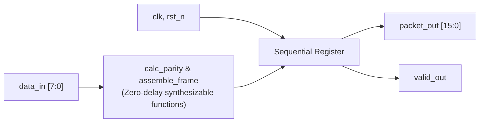
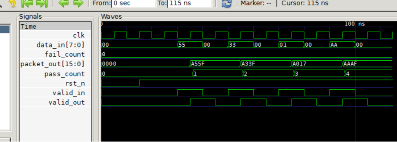

# Chapter 8: Tasks and Functions (Packet Formatter & Verification Engine)

Following **Chapter 8** of *Verilog HDL: A Guide to Digital Design and Synthesis* by Samir Palnitkar.

---

## 📌 Architecture & Design Purpose

This lab demonstrates modular subprograms by implementing **synthesizable functions in RTL** and **timed reusable tasks in verification**:



### Core Concepts Covered:
1. **Synthesizable Functions (`function ... endfunction`)**:
   - Zero simulation time combinational logic computation.
   - Bit parity generator (`calc_parity`) and frame assembly (`assemble_frame`).
2. **Timing-Consuming Tasks (`task ... endtask`)**:
   - Automated stimulus driving across clock edges (`send_and_verify`).
   - Self-checking verification logging automatic `[PASS]` and `[FAIL]` status.
3. **Re-entrant Automatic Tasks (`task automatic`)**:
   - Dynamic stack allocation for cycle counters (`delay_cycles`).

---

## 📊 GTKWave Simulation Waveform



### Key Waveform Observations:
1. **Frame 1 (Payload `0x55`)**:
   - Synchronous pulse on `valid_in` with `data_in = 8'h55`.
   - On the next clock edge, `valid_out = 1` and `packet_out = 16'hA55F`!
2. **Frame 2 (Payload `0x33`)**:
   - `data_in = 8'h33` $\implies$ outputs `packet_out = 16'hA33F` with odd parity $= 1$.
3. **Frame 3 (Payload `0x01`)**:
   - `data_in = 8'h01` $\implies$ outputs `packet_out = 16'hA017` with odd parity $= 0$.
4. **Frame 4 (Payload `0xAA`)**:
   - `data_in = 8'hAA` $\implies$ outputs `packet_out = 16'hAAAF` with odd parity $= 1$.

---

## 🚀 How to Run Simulation

```bash
# 1. Compile
C:\iverilog\bin\iverilog.exe -o sim.vvp packet_formatter.v tb_packet_formatter.v

# 2. Simulate
C:\iverilog\bin\vvp.exe sim.vvp

# 3. View Waveforms
C:\iverilog\gtkwave\bin\gtkwave.exe packet_formatter.vcd
```
