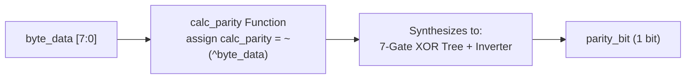
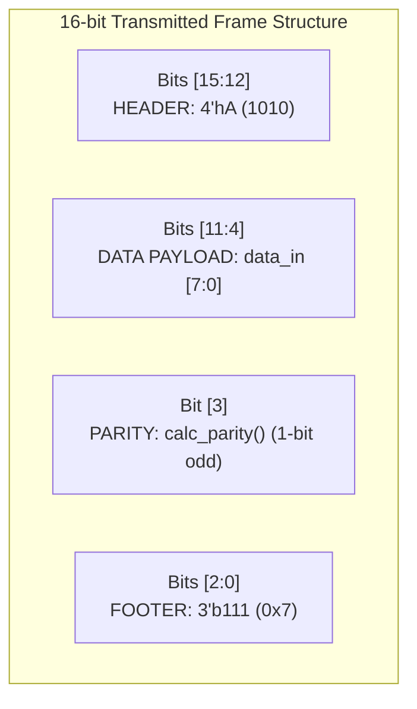

# Chapter 8: Tasks and Functions — Modularity, Synthesis & Verification

Reference: *Verilog HDL: A Guide to Digital Design and Synthesis* by Samir Palnitkar (Chapter 8, Sections 8.1 – 8.4).

---

## 1. What are Tasks and Functions?

In Verilog, when the same sequence of statements or calculation needs to be repeated in multiple places, writing duplicate code creates bugs and reduces readability.
Verilog provides two modular procedural subprograms:
- **`function`**: Designed for zero-delay combinational computations. Returns a single scalar or vector value.
- **`task`**: Designed for general-purpose procedural operations that can consume simulation time and have multiple inputs/outputs.

---

## 2. Comparison Matrix: Tasks vs. Functions

| Comparison Criteria | `function` | `task` |
| :--- | :--- | :--- |
| **Simulation Time** | **Strictly 0 simulation time**. Cannot contain `#`, `@`, or `wait`. | **Can consume simulation time** (`#10`, `@(posedge clk)`, `wait(ready)`). |
| **Return Mechanism** | Returns a **single value** by assigning to the function name. | Does **not return a value** directly; outputs are returned through argument lists (`output`, `inout`). |
| **RHS vs Statement** | Can be invoked on the **Right-Hand Side (RHS)** of an expression (e.g. `assign y = func(a);`). | Invoked as a **standalone procedural statement** (e.g. `send_packet(data);`). |
| **Synthesis Support** | **Synthesizable**: Maps cleanly to combinational logic (XOR trees, adders, decoders). | **Non-synthesizable** when containing timing controls; used in testbenches and bus functional models. |
| **Subprogram Calls** | Can call other functions; **cannot** call tasks. | Can call other tasks **and** functions. |
| **Input Arguments** | Must have **at least one input** argument. | Can have **zero or more** inputs/outputs/inouts. |

---

## 3. Hardware Synthesis of Functions

When a function is synthesized, the synthesis tool expands the function inline into pure combinational hardware standard cells:



Because functions cannot contain clocks or `#` delays, they are mathematically guaranteed to synthesize into a direct acyclic combinational graph with zero latches!

---

## 4. Re-entrant Subprograms: The `automatic` Keyword

By default in Verilog-1995, all variables declared inside tasks and functions are **static** (they share a single global memory address).
- If a task is invoked concurrently from multiple `fork-join` threads, or called recursively, one invocation will overwrite the variables of another invocation!

### The Solution: `automatic` (Verilog-2001)
Declaring `task automatic` or `function automatic` instructs the simulator to allocate local variables dynamically on the **stack** for every individual call:

```verilog
// Re-entrant cycle delay: each caller gets its own independent copy of 'i'
task automatic delay_cycles(input integer num_cycles);
    integer i;
    begin
        for (i = 0; i < num_cycles; i = i + 1)
            @(posedge clk);
    end
endtask
```

---

## 5. Packet Framing Architecture (16-bit Frame)

In our lab, two functions cooperate to assemble an outgoing 16-bit communications frame:



### Verification Vectors Trace:
1. **Payload `0x55`** (`0101_0101` $\implies$ 4 ones $\implies$ odd parity bit $= 1$):
   $$\{4\text{'hA}, 8\text{'h55}, 1\text{'b1}, 3\text{'b111}\} = \mathbf{16\text{'hA55F}}$$
2. **Payload `0x33`** (`0011_0011` $\implies$ 4 ones $\implies$ odd parity bit $= 1$):
   $$\{4\text{'hA}, 8\text{'h33}, 1\text{'b1}, 3\text{'b111}\} = \mathbf{16\text{'hA33F}}$$
3. **Payload `0x01`** (`0000_0001` $\implies$ 1 one $\implies$ odd parity bit $= 0$):
   $$\{4\text{'hA}, 8\text{'h01}, 1\text{'b0}, 3\text{'b111}\} = \mathbf{16\text{'hA017}}$$
4. **Payload `0xAA`** (`1010_1010` $\implies$ 4 ones $\implies$ odd parity bit $= 1$):
   $$\{4\text{'hA}, 8\text{'hAA}, 1\text{'b1}, 3\text{'b111}\} = \mathbf{16\text{'hAAAF}}$$
