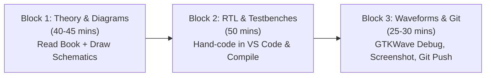

# 🧠 Project Memory & Master Execution Log
> **Repository**: [pavan8932/verilog-journey](https://github.com/pavan8932/verilog-journey)  
> **Author**: Pavan Chitted  
> **Primary Reference**: *Verilog HDL: A Guide to Digital Design and Synthesis (2nd Edition)* by Samir Palnitkar  
> **Standard**: IEEE 1364-2001 Verilog HDL  
> **Timeline**: 10–12 Weeks | **Daily Commitment**: 2 Hours/Day (~140–160 Hours Total)  
> **Last Updated**: 2026-10-23  

---

## 🎯 Project Mission & Vision
The mission of this repository is to achieve end-to-end mastery of **Verilog HDL**, digital design methodology, synthesizable RTL architecture, and hardware verification from absolute scratch. 

By the end of this roadmap, this repository will serve as an industry-grade portfolio containing:
1. Complete, self-written RTL and testbenches for all core chapters of Samir Palnitkar's textbook.
2. Verified timing and waveform traces via **GTKWave** for 100% of designs.
3. Three production-grade GitHub portfolio projects:
   - **Milestone Project 1**: Parameterized Synchronous FIFO & 32-bit ALU.
   - **Milestone Project 2**: Full-Duplex Configurable UART with 16x Oversampling & FIFOs.
   - **Capstone Project 3**: 5-Stage Pipelined RISC-V (RV32I) Processor Core / AXI4-Lite Multi-Peripheral Subsystem.

---

## 📐 The Golden Engineering Standards (Non-Negotiable)

Every design committed to this repository strictly adheres to three rules:
1. **The 100% Testbench Rule**: No hardware module (`<module>.v`) exists without a dedicated self-checking stimulus block (`tb_<module>.v`). Unverified RTL is considered broken.
2. **Mandatory GTKWave Dump**: Every testbench must include `$dumpfile("<module>.vcd");` and `$dumpvars(0, tb_<module>);` to generate value change dump traces for waveform analysis.
3. **Visual Verification Proof**: Waveforms are inspected in GTKWave for setup/hold integrity, clock edges, and state transitions, with waveform screenshots documented in each lab's `README.md`.

---

## 🛠️ Toolchain & Environment Specifications

| Component | Tool / Standard | Details / Path |
| :--- | :--- | :--- |
| **Operating System** | Windows 11 | PowerShell / CMD |
| **HDL Standard** | Verilog-2001 | IEEE 1364-2001 |
| **Compiler & Simulator** | Icarus Verilog (`iverilog`) | `C:\iverilog\bin\iverilog.exe` |
| **Simulation Runtime** | VVP (`vvp`) | `C:\iverilog\bin\vvp.exe` |
| **Waveform Viewer** | GTKWave (`gtkwave`) | `C:\iverilog\gtkwave\bin\gtkwave.exe` |
| **Editor** | Visual Studio Code | Extensions: *Verilog-HDL/SystemVerilog*, *WaveTrace* |
| **Version Control** | Git & GitHub | Remote: `git@github.com:pavan8932/verilog-journey.git` |

---

## ⏱️ Daily 2-Hour Study & Execution Framework

Each 2-hour daily block is strictly divided into three productive segments:



1. **Block 1 (00–45 mins)**: Study assigned chapter sections in Samir Palnitkar. Draw circuit schematics and state diagrams by hand before writing code.
2. **Block 2 (45–95 mins)**: Code the synthesizable RTL module and stimulus testbench from scratch.
3. **Block 3 (95–120 mins)**: Compile with `iverilog`, execute with `vvp`, inspect waveforms in GTKWave, capture waveform screenshot, and push to GitHub.

---

## 🗺️ Master Curriculum & Progress Tracker

### Phase 1: Foundations & Modeling Paradigms (Weeks 1–3)
- [x] **Day 1–2 (Ch 1 & Ch 2)**: Design Flow & Hierarchical Modeling
  - [x] Lab: 4-bit Asynchronous Ripple Carry Counter (`dff.v`, `tff.v`, `ripple_carry_counter.v`, `tb_ripple_carry_counter.v`).
  - [x] Simulation verified in `iverilog` + `gtkwave`.
  - [x] Waveform screenshot documented and pushed to GitHub.
  - [x] Book reading reference: Pages 11–26 (PDF Pages 37–52).
- [ ] **Day 3–5 (Ch 3)**: Basic Concepts & Lexical Conventions
  - [ ] 4-value logic system (`0`, `1`, `x`, `z`).
  - [ ] Net types (`wire`, `tri`) vs. Register types (`reg`, `integer`, `time`).
  - [ ] Numbers, vector slicing, and memories (`reg [7:0] mem [0:255]`).
  - [ ] System tasks: `$display`, `$monitor`, `$time`, `$finish`, `$dumpfile`, `$dumpvars`.
  - [ ] Compiler directives: `` `timescale ``, `` `define ``, `` `include ``.
- [ ] **Day 6–7 (Ch 4)**: Modules and Ports
  - [ ] Module declarations and ANSI C-style port lists (Verilog-2001).
  - [ ] Port connection rules: By Name (`.port(signal)`) vs. By Position.
  - [ ] Hierarchical names and signal probing across scopes.
- [ ] **Day 8–10 (Ch 5)**: Gate-Level Modeling
  - [ ] Built-in gate primitives (`and`, `nand`, `or`, `nor`, `xor`, `xnor`, `buf`, `not`).
  - [ ] Gate delays: rise, fall, turn-off delays, min/typ/max specifications.
  - [ ] Lab: 4-to-1 MUX, 3-to-8 Decoder, 4-bit Ripple-Carry Adder from gates.
- [ ] **Day 11–14 (Ch 6)**: Dataflow Modeling
  - [ ] Continuous assignments (`assign`) and evaluation semantics.
  - [ ] Operators: Arithmetic, Logical, Bitwise, Reduction, Shift, Concatenation `{}`, Replication.
  - [ ] Conditional operator (`? :`) for hardware multiplexers.
  - [ ] Lab: 16-bit Carry-Lookahead Adder (CLA) & 8-bit combinational ALU.

---

### Phase 2: Behavioral Modeling, FSMs & Testbenches (Weeks 4–6)
- [ ] **Day 15–18 (Ch 7)**: Behavioral Modeling & Structured Procedures
  - [ ] `initial` blocks vs. `always` blocks.
  - [ ] **Golden Rule**: Blocking (`=`) vs. Non-blocking (`<=`) assignments.
  - [ ] Transparent latch avoidance (complete `if-else` and `case` with `default`).
  - [ ] Synthesizable loops (`for` loops with constant bounds).
  - [ ] Lab: Universal Shift Register & Configurable Modulo-N Counter.
- [ ] **Day 19–21 (Ch 7)**: Finite State Machines (FSMs)
  - [ ] Mealy vs. Moore state machine architectures.
  - [ ] 1-process vs. 2-process vs. 3-process FSM coding styles (Industry Standard 3-process).
  - [ ] State encodings: Binary, One-Hot, Gray Code.
  - [ ] Lab: Sequence Detector (`10110`) & Traffic Light Controller.
- [ ] **Day 22–24 (Ch 8 & 9)**: Tasks, Functions & Advanced Techniques
  - [ ] Tasks vs. Functions: synthesis rules and testbench drivers.
  - [ ] Module parameters (`parameter`, `localparam`) and instantiation overrides (`#(...)`).
  - [ ] Generate blocks (`generate ... endgenerate`, `genvar`).
- [ ] **Day 25–28**: 🏆 **Milestone Project 1**
  - [ ] Parameterized Synchronous FIFO (`DEPTH`, `DATA_WIDTH`, pointers, status flags).
  - [ ] 32-bit ALU with 16 arithmetic/logical operations.
  - [ ] Self-checking testbench with randomized stimulus and assertions.

---

### Phase 3: Synthesis, Timing & Hardware Design (Weeks 7–8)
- [ ] **Day 29–32 (Ch 14)**: Logic Synthesis with Verilog HDL
  - [ ] RTL to Gate-level translation and technology mapping.
  - [ ] Synthesizable vs. non-synthesizable constructs checklist.
  - [ ] Hardware resource sharing (adders, comparators, multipliers).
  - [ ] Memory synthesis (Distributed LUT RAM vs. Block RAM inference).
- [ ] **Day 33–35 (Ch 10 & Advanced)**: Timing, Delays & Clock Domain Crossing (CDC)
  - [ ] Setup time ($T_{su}$), Hold time ($T_{h}$), Clock-to-Q ($T_{cq}$), Timing slack.
  - [ ] Path delay modeling and `specify` blocks.
  - [ ] Metastability & Clock Domain Crossing (Dual flip-flop synchronizers).
  - [ ] Overview of Ch 11 (Switch-Level), Ch 12 (UDPs), Ch 13 (PLI/VPI).

---

### Phase 4: Capstone Portfolio Projects (Weeks 9–12)
- [ ] **Weeks 9–10**: 🏆 **Milestone Project 2 — Full-Duplex Configurable UART Core**
  - [ ] Baud Rate Generator with 16x oversampling accumulator.
  - [ ] UART Transmitter with FSM and parity generator.
  - [ ] UART Receiver with 3-sample majority voting center filter.
  - [ ] Integrated TX & RX FIFO buffers.
  - [ ] Full loopback testbench with simulated channel noise.
- [ ] **Weeks 11–12**: 🏆 **Capstone Project 3 — Specialization Choice**
  - [ ] **Option A**: 5-Stage Pipelined RISC-V (RV32I) Processor Core with forwarding and hazard detection.
  - [ ] **Option B**: AXI4-Lite SPI & I2C Master Controller Subsystem.
  - [ ] Automated GitHub Actions CI workflow (running `iverilog` on every push).

---

## 📓 Daily Execution Journal

| Date | Day # | Chapter | Topic / Lab Completed | Artifacts Created | Status |
| :---: | :---: | :---: | :--- | :--- | :---: |
| **2026-10-23** | Day 1–2 | Ch 1 & 2 | **Hierarchical Modeling & 4-bit Ripple Carry Counter**<br>- Installed Icarus Verilog & GTKWave on Windows.<br>- Initialized Git repo, created `.gitignore` and `README.md`.<br>- Hand-coded `dff.v`, `tff.v`, `ripple_carry_counter.v`, `tb_ripple_carry_counter.v`.<br>- Ran simulation with `iverilog` & `vvp`.<br>- Verified 10ns clock and binary count in GTKWave.<br>- Documented waveform and committed to GitHub. | - [`labs/ch02_hierarchical/`](./labs/ch02_hierarchical/)<br>- `waveform.png`<br>- `counter.vcd` | ✅ **DONE** |
| **Upcoming** | Day 3 | Ch 3 | **Basic Concepts, Data Types & 4-State Logic** | `labs/ch03_basic_concepts/` | ⏳ Pending |

---

## 💡 How to Update This File Daily
1. At the start of each study session, check the **Master Curriculum** to see the day's focus.
2. At the end of the 2-hour session:
   - Check the completed boxes `[x]`.
   - Add a new row to the **Daily Execution Journal** with the date, designs implemented, and status.
   - Stage and commit with:
     ```bash
     git add project_memory.md
     git commit -m "Docs: Update project_memory.md for Day X progress"
     git push
     ```
